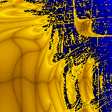
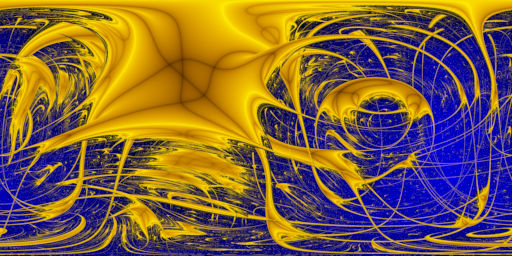
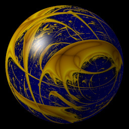
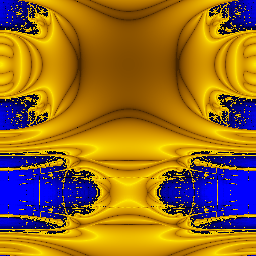
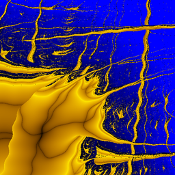
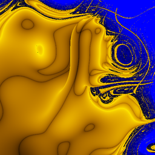
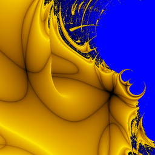

# lyapunov – a 2D/3D Lyapunov fractal generator


These programs are in this repo:
## lyapunov
### Requirements
(none, except a libc with getopt() support)
### Compilation

Use `cmake`.

### Running
```
Generate Lyapunov fractal(s) as PPM or 3df to stdout or file(s)

Usage: lyapunov [-W width] [-H height] [-f frames] [-s sequence] [-i max_iter]
     [-t fractal_type ] [-o output_filename_base] [-O format]
   { [-c center_x:center_y:size] | [-x min_x] [-X max_x] [-y min_y] [-Y max_y] } [-z min_z] [-Z max_z]
     [-C value] [-D value] [-E value] [-F value]

        -W width  : width of image in pixel (default: 800)
        -H height : height of image in pixel (default: 800)
        -f frames : number of frames or size in in z direction
        -s seq    : AB or ABC sequence for fractal (default: "BBBABBAAAAAA")
        -i iter   : iterations per pixel (default: 1000)

        -t type    : fractal type (default: plain, run "-t help" to get a list of types)
        -o outfile : basename of the output file (stdout if not given)
                     Can contain template patterns: {s}: sequence, {i}: iter, {f}: frame_nr
        -O format  : either "pnm" for image (series) or "3df" for 3D voxel file (default: "pnm")

        -c cx:cy:x_size : center coordinates and size.
           The x, X, y and Y values will be calculated from them automatically:
        -x min_x  : minimum x value (default: 2.400000)
        -X max_x  : maximum x value (default: 3.999000)
        -y min_y  : minimum y value (default: 3.999000)
        -Y max_y  : maximum y value (default: 2.400000)
        -z min_z  : 3rd dimension: (start) value of z. (selected by "C" in sequence string. default: 2.500000)
        -Z max_z  : maximum value of z (default: 4.000000)
        -C value  : value for 3th dimension (default 2.500000)
        -D value  : value for 4th dimension (default 3.700000)
        -E value  : value for 5th dimension (default 3.000000)
```


#### Fractal types
* `plain`  : just a 2D image or an animation of a linear flight through the 3D cube
* `6sides` : animated cruise through all 6 sides of the ABC cube.
* `circle` : values for C and D form a circle: Center is at `(z_min + z_max)/2`, D.  Radius is `abs(z_max-z_min)/2`.
* `sphere` : a sphere in the ABC cube. D+E can form a circle in animation mode.
* `tileable` : A and B each trace a full circle in the parameter plane, so the image repeats seamlessly in both directions (wallpaper).
* `tileable-loop` : like `tileable`, plus C+D trace a circle over the frames (`-f <frames>`), so the animation loops seamlessly (frame N = frame 0).
* `zoom` : animated fly-through into the (A,B) plane: over the whole animation the rectangle is scaled about its center (total zoom factor, final frame scale relative to frame 0) and rotated (total degrees), configured via `-p <total_zoom>,<total_rotation>` (default `0.1,360`).
* `wavy` : the plain (A,B) plane with a sinusoidal warp (A wobbles along the columns, B along the lines, woven wave pattern), configured via `-p <freq_a>,<amp_a>,<phase_a>[,<freq_b>,<amp_b>,<phase_b>]`: frequency = number of waves per image axis (1 = one wave), amplitude = fraction of the image size (0.02 by default), phase in degrees (360 = one wave); the B triple defaults to the A values (default `1,0.02,0`).
* `noise` : the plain (A,B) plane warped by 2D Perlin noise, configured via `-p <frequency>,<amp_a>,<amp_b>[,<seed>]`: frequency = number of noise cells per image axis (1 = one cell), amplitude = fraction of the image size (0.333 by default), optional seed (default `3,0.333,0.333,0`). In animations the amplitude grows linearly from 0 to the given value over the frames (single frame: full amplitude).
* `inversion` : the plain (A,B) plane, but the points are reflected about a fixed circle: for each point the distance `d` and angle from the circle center are computed, then projected to the radius `R²/d` at the same angle (`P' = C + R²·(P−C)/|P−C|²`), configured via `-p [center_a,center_b[,radius]]` (default: window center, radius half of the A range, i.e. half the image size).


#### File formats
* ppm : portable pixmap image, or series of images
* 3df : 3D voxel file, suitable for POV-Ray renderer and others

Animations can be viewed via ImageMagick's `animate` command-line tool (if not too big, because all images must fit in RAM!):
```
animate -delay 5 -verbose ani-*.ppm
```
or by converting them to a video file, e.g. with ffmpeg:
```
ffmpeg -i ani-ABCD-%03d.ppm -r 25 ani.mp4
```

### Examples

#### Circle animation


`lyapunov -W 320 -H 320 -f 320 -t circle -s ABCDBBCDDA -c 3.48:3.48:1 -z 3.1 -Z 3.6 -D 3.375 -o ani-{s}-{f}`

<br clear="all">

#### Sphere


`lyapunov -W 1024 -H 512 -t sphere -x 3.2 -X 3.8 -y 3.2 -Y 3.8 -z 3.1 -Z 3.8 -s ABCBBACC -o sphere.ppm`

This image is a "spherical mapping" that can be used e.g. with POV-Ray to render a 3D image, see <code>pov/</code> subdirectory.




Animation: https://github.com/user-attachments/assets/938d0b7e-1d54-40de-93c9-f0879bf6ffdf

A second animation example is in the pov/ directory.


<br clear="all" />

#### Tileable


`lyapunov -W 256 -H 256 -s ABABC -t tileable -o tileable.ppm`

This image tiles seamlessly in both directions (wallpaper): the left edge continues at the right edge and vice versa, the same for top and bottom.

<br clear="all" />

#### Wavy


`lyapunov -W 512 -H 512 -i 400 -s ABBABA -x 3.0 -X 4.0 -y 4.0 -Y 3.0 -t wavy -p 10,0.002,0,10,0.006,0 -o wavy.ppm`

The (A,B) plane with a sinusoidal warp: 10 waves per axis, amplitude of A is 2% of the image size, amplitude of B 6%, phase 0 degrees for both.

A 6x6 grid of these images (amplitude of A 0.000...0.010 in the rows, amplitude of B 0.000...0.010 in the columns, 10 pixel gap, each image labeled with its amplitudes): [montage-6x6.png](img/montage-6x6.png)

<br clear="all" />

#### Noise


`lyapunov -W 512 -H 512 -i 400 -s ABBABA -t noise -o noise.ppm`

The (A,B) plane warped by 2D Perlin noise, configured via `-p <frequency>,<amp_a>,<amp_b>[,<seed>]` (default: `3,0.333,0.333,0`).

<br clear="all" />

#### Inversion


`lyapunov -W 512 -H 512 -i 400 -s ABBABA -t inversion -p 3.2,3.8 -o inversion.ppm`

Every point of the (A,B) plane is reflected about the fixed inversion circle: the distance `d` and the angle from the circle center are computed, then the point is projected to the radius `R²/d` at the same angle (`P' = C + R²·(P−C)/|P−C|²`). Configured via `-p [center_a,center_b[,radius]]` (default: window center, radius half of the A range, i.e. half the image size).

<br clear="all" />

## gen-ab-sequences
Prints all non-repetitive AB sequences (that starts with A) to stdout. Sequences starting with B would produce the same images as the sequences with all A's and B's interchanged, except mirrored by the x=y axis.

## gen_zoom
Prints a lot of command lines for the "lyapunov" program to stdout. Running these programs would create a lot of images that shows a lyapunov fractal zoom.

